<!-- SPDX-License-Identifier: GPL-3.0-or-later -->
<!-- Copyright (C) 2026 KR4OYK - David Kuder -->

# OYK-Node UI Gallery

Automated screenshots generated across all six operator interfaces from live UI flow tests (`./scripts/generate_ui_gallery.sh`).

Each tested operator workflow is grouped below so visual layout, tab structure, and feature parity can be compared across **POSIX ncurses**, **MS-DOS**, **Teensy 4.1 TinyTMUX**, **X11 GTK+ 2.0**, **Windows**, and **Android**.

## 1. Operator Console (Main View)

### POSIX ncurses

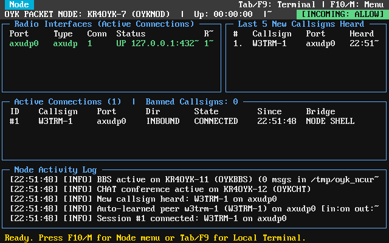

### MS-DOS (80x25 Text)

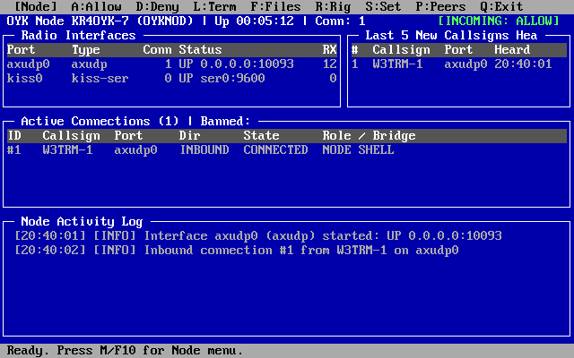

### Teensy 4.1 / TinyTMUX (VT340/xterm-256color)

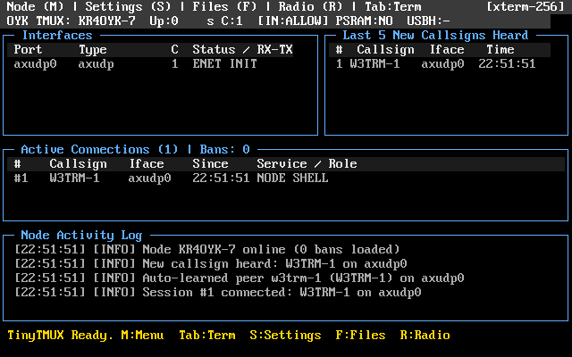

### X11 GTK+ 2.0

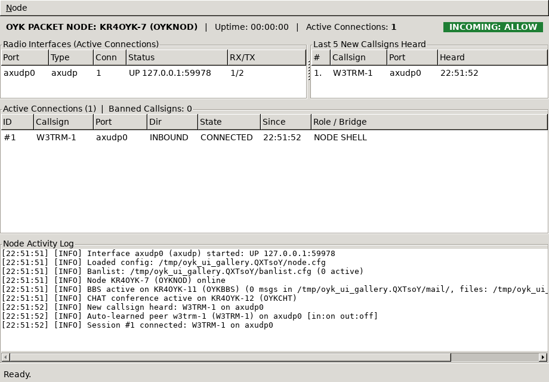

### Windows GUI (Wine / Win32/64)

### Android (Material 3 / Jetpack Compose)

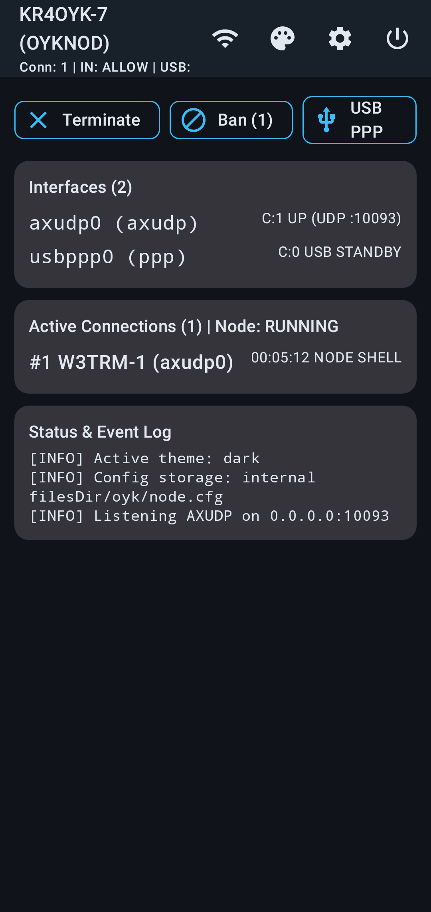

## 2. Settings — Node Tab

### POSIX ncurses

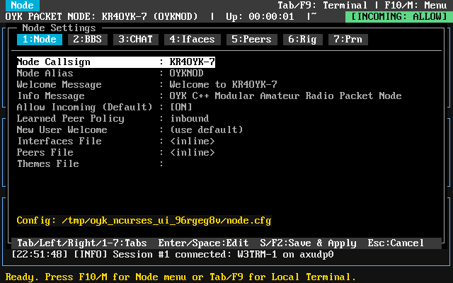

### MS-DOS (80x25 Text)

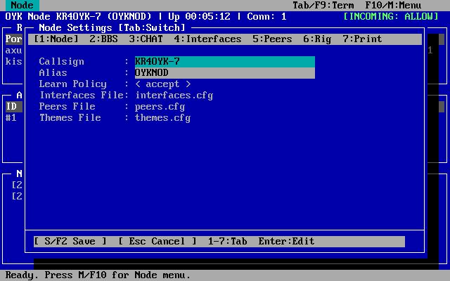

### Teensy 4.1 / TinyTMUX (VT340/xterm-256color)

### X11 GTK+ 2.0

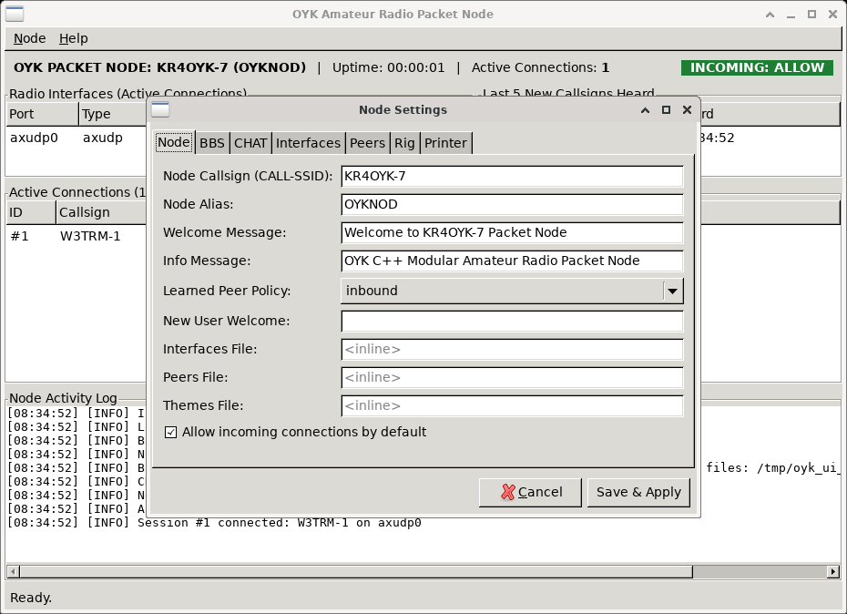

### Windows GUI (Wine / Win32/64)

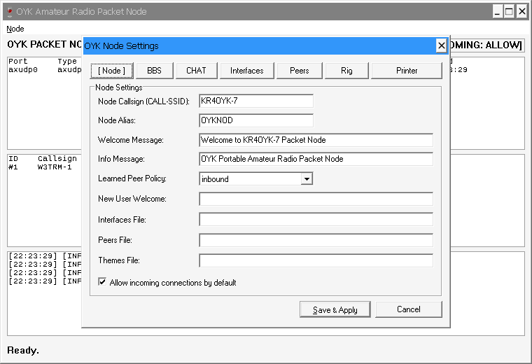

### Android (Material 3 / Jetpack Compose)

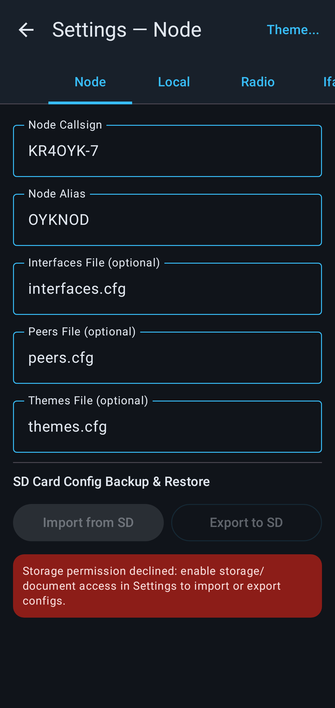

## 3. Add Interface Wizard

### POSIX ncurses

### MS-DOS (80x25 Text)

### Teensy 4.1 / TinyTMUX (VT340/xterm-256color)

### X11 GTK+ 2.0

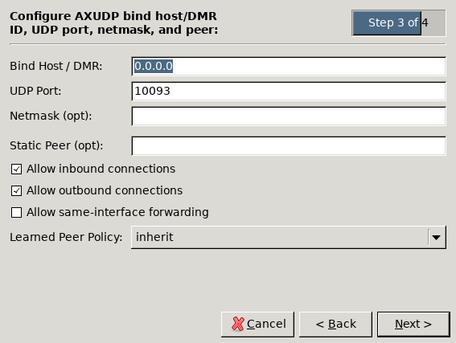

### Windows GUI (Wine / Win32/64)

### Android (Material 3 / Jetpack Compose)

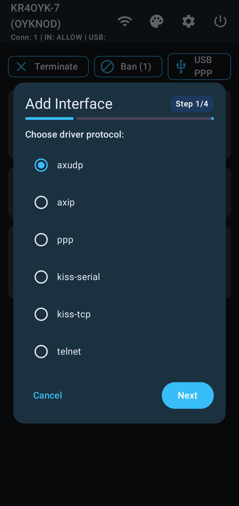

## 4. Edit Interface (Single-View Dialog)

### POSIX ncurses

### MS-DOS (80x25 Text)

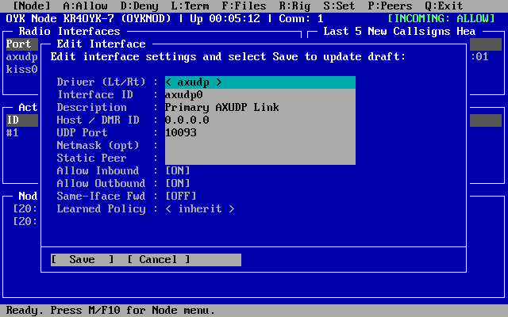

### Teensy 4.1 / TinyTMUX (VT340/xterm-256color)

### X11 GTK+ 2.0

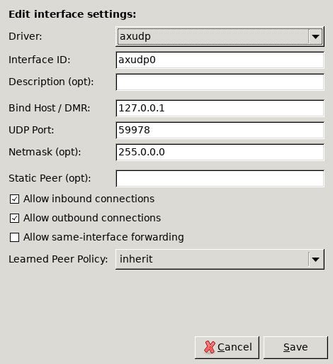

### Windows GUI (Wine / Win32/64)

### Android (Material 3 / Jetpack Compose)

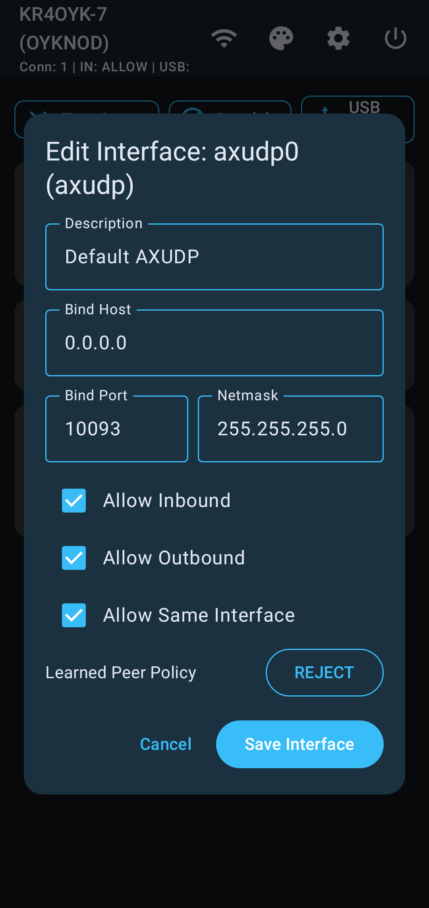

## 5. Settings — Peers Tab

### POSIX ncurses

### MS-DOS (80x25 Text)

### Teensy 4.1 / TinyTMUX (VT340/xterm-256color)

### X11 GTK+ 2.0

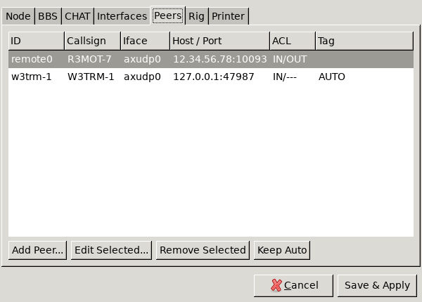

### Windows GUI (Wine / Win32/64)

### Android (Material 3 / Jetpack Compose)

## 6. Edit / Add Peer Dialog

### POSIX ncurses

### MS-DOS (80x25 Text)

### Teensy 4.1 / TinyTMUX (VT340/xterm-256color)

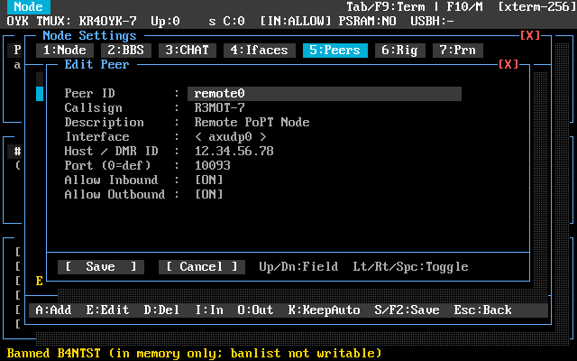

### X11 GTK+ 2.0

### Windows GUI (Wine / Win32/64)

### Android (Material 3 / Jetpack Compose)

## 7. Terminate Connection Modal

### POSIX ncurses

### MS-DOS (80x25 Text)

### Teensy 4.1 / TinyTMUX (VT340/xterm-256color)

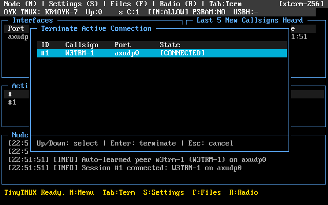

### X11 GTK+ 2.0

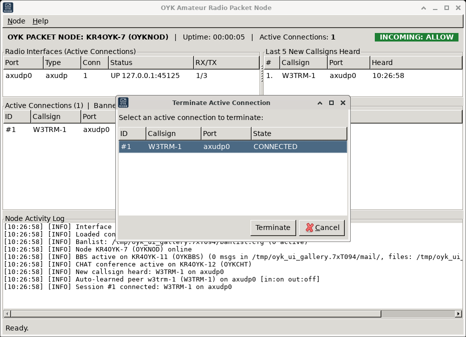

### Windows GUI (Wine / Win32/64)

### Android (Material 3 / Jetpack Compose)

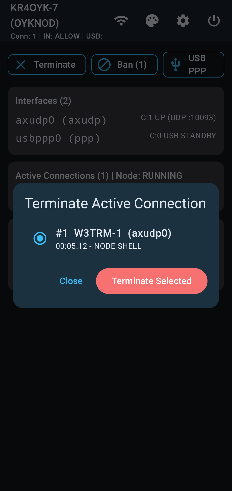

## 8. Ban / Unban Callsign Dialog

### POSIX ncurses

### MS-DOS (80x25 Text)

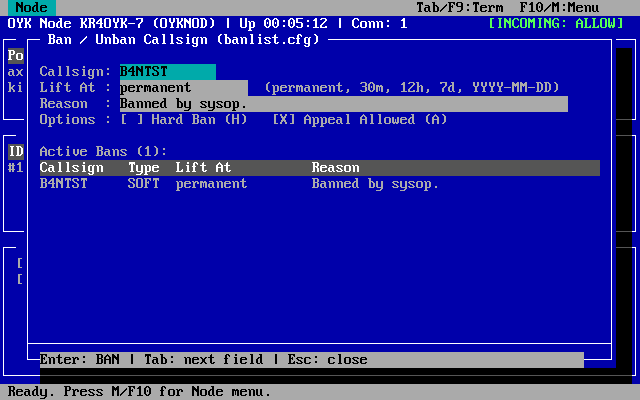

### Teensy 4.1 / TinyTMUX (VT340/xterm-256color)

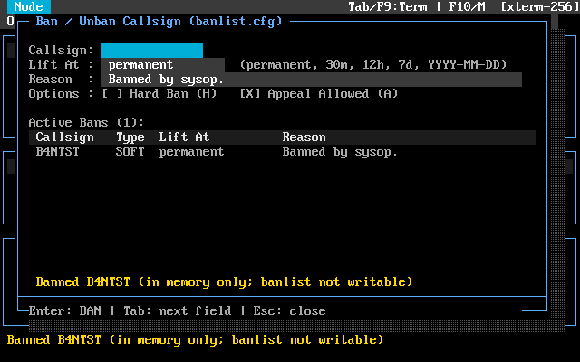

### X11 GTK+ 2.0

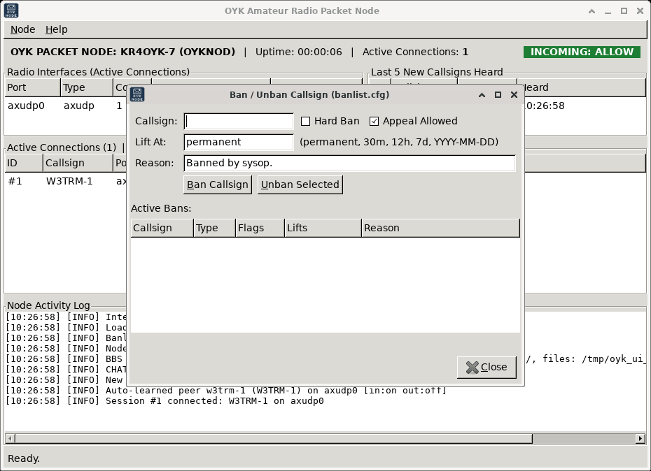

### Windows GUI (Wine / Win32/64)

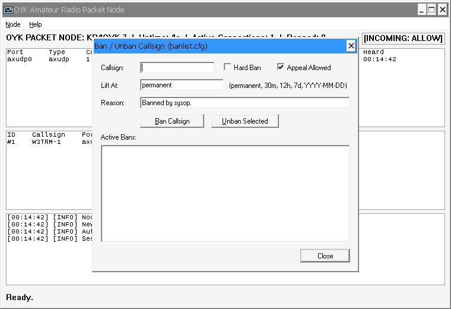

### Android (Material 3 / Jetpack Compose)

## 9. Auto-Learned Peers Exit / Bootloader Prompt

### POSIX ncurses

### MS-DOS (80x25 Text)

### Teensy 4.1 / TinyTMUX (VT340/xterm-256color)

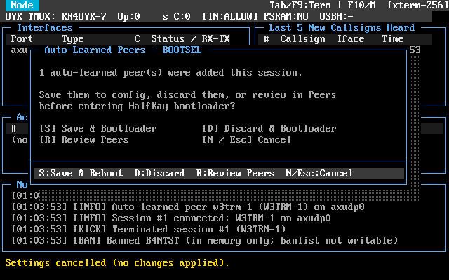

### X11 GTK+ 2.0

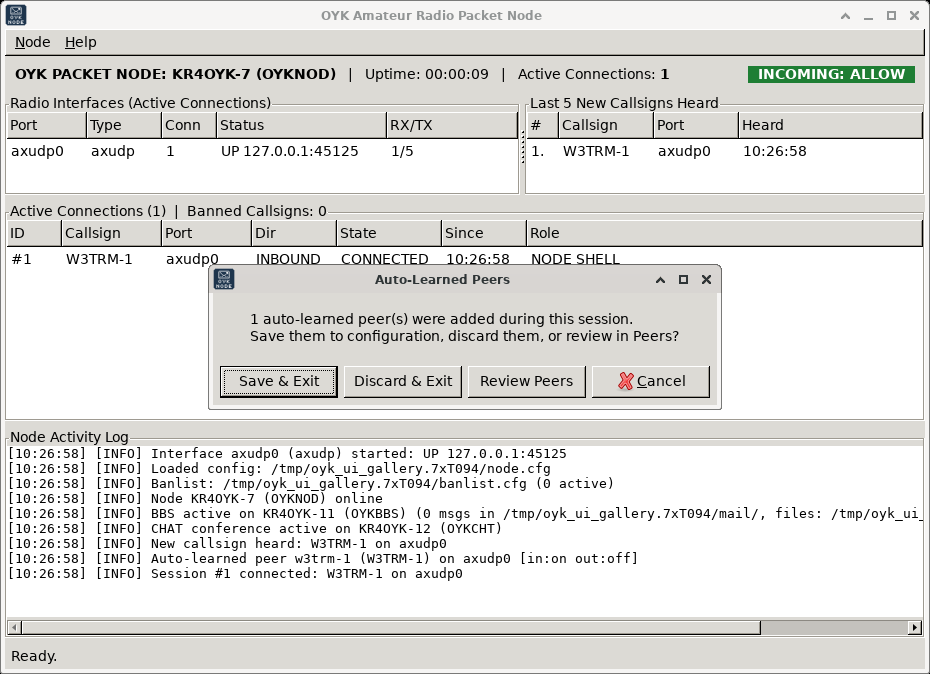

### Windows GUI (Wine / Win32/64)

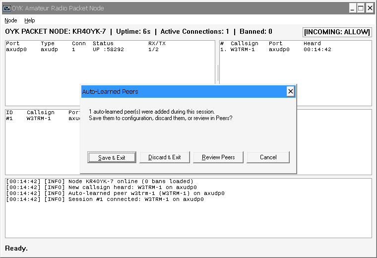

### Android (Material 3 / Jetpack Compose)

## 10. Theme Settings Dialog

### POSIX ncurses

### MS-DOS (80x25 Text)

### Teensy 4.1 / TinyTMUX (VT340/xterm-256color)

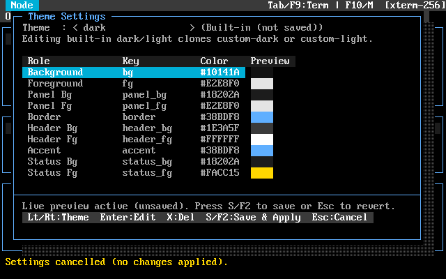

### X11 GTK+ 2.0

### Windows GUI (Wine / Win32/64)

### Android (Material 3 / Jetpack Compose)

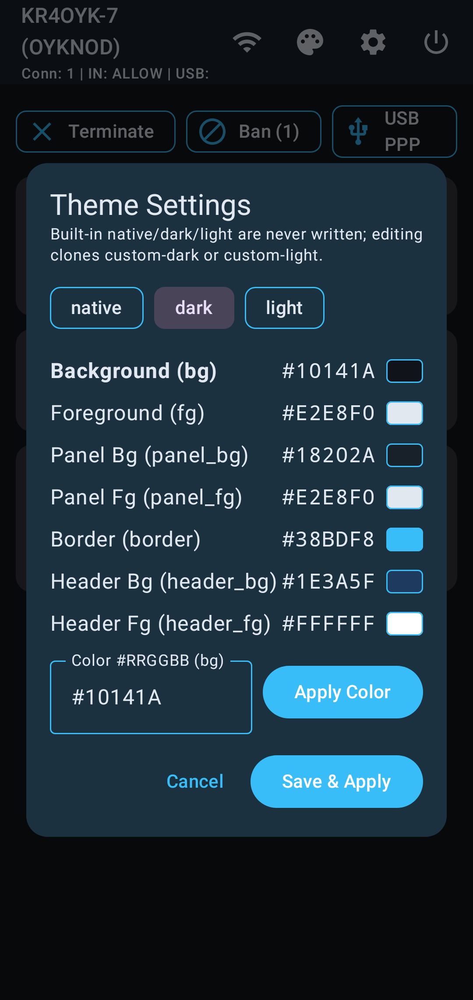

