<!-- SPDX-License-Identifier: GPL-3.0-or-later -->
<!-- Copyright (C) 2026 KR4OYK - David Kuder -->

# OYK-Node UI Gallery

Automated native-resolution screenshots and per-port thumbnail contact sheets generated across all 22 canonical operator screens (`./scripts/generate_ui_gallery.sh`).

Click any thumbnail in the port tables below to open the full-resolution native PNG capture.

## Table of Contents

- [POSIX ncurses](#ncurses)
- [MS-DOS (80x25 Text)](#dos)
- [MS-DOS 386+ Graphical (VBE/VGA/EGA)](#dos_gfx)
- [Teensy 4.1 / TinyTMUX (VT340/xterm-256color)](#tinytmux)
- [Raspberry Pi Pico (RP2040/RP2350 VT340/xterm-256color)](#pico)
- [ESP32-C6 (M5Stack Unit C6L VT340/xterm-256color)](#esp32c6)
- [X11 GTK+ 2.0](#gtk)
- [Windows GUI (Wine / Win32/64)](#win)
- [Android (Material 3 / Jetpack Compose)](#android)
- [Classic Macintosh (System 6.0.8 B&W 512x342)](#macclassic_bw)
- [Classic Macintosh (Color QuickDraw 640x480)](#macclassic_color)
- [Apple IIGS GS/OS (QuickDraw II 640x200)](#gsos)
- [Amiga Workbench (Intuition/GadTools OS 3.1/2.04/1.3 + AROS)](#amiga)
- [Atari ST GEM (ST High 640x400 Monochrome + EmuTOS)](#atarist_mono)
- [Atari TT / VDI GEM (640x480 16-Color + EmuTOS)](#atarist_color)

## POSIX ncurses

| | | | |
| :---: | :---: | :---: | :---: |
| [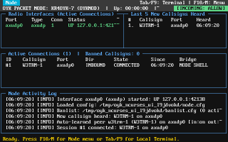](images/ui-gallery/ncurses_main.png) **1. Console** | [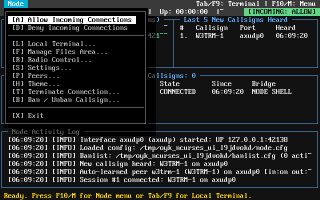](images/ui-gallery/ncurses_menu.png) **2. Node Menu** | [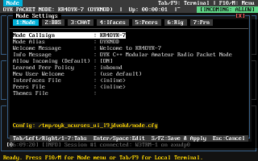](images/ui-gallery/ncurses_settings.png) **3. Set: Node** | [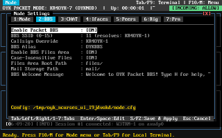](images/ui-gallery/ncurses_settings_bbs.png) **4. Set: BBS** |
| [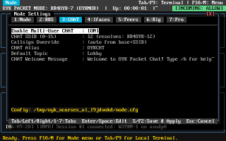](images/ui-gallery/ncurses_settings_chat.png) **5. Set: CHAT** | [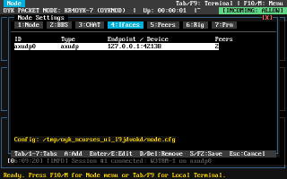](images/ui-gallery/ncurses_settings_ifaces.png) **6. Set: Ifaces** | [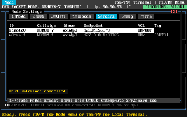](images/ui-gallery/ncurses_peers.png) **7. Set: Peers** | [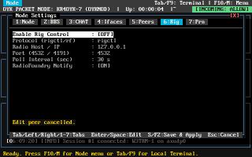](images/ui-gallery/ncurses_settings_rig.png) **8. Set: Rig** |
| [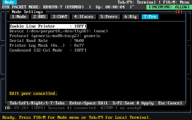](images/ui-gallery/ncurses_settings_printer.png) **9. Set: Printer** | [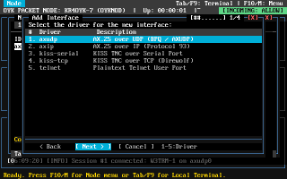](images/ui-gallery/ncurses_add_iface_1.png) **10. Wiz 1: Driver** | [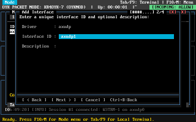](images/ui-gallery/ncurses_add_iface_2.png) **11. Wiz 2: Identity** |  **12. Wiz 3: Policy** |
| [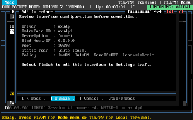](images/ui-gallery/ncurses_add_iface_4.png) **13. Wiz 4: Review** | [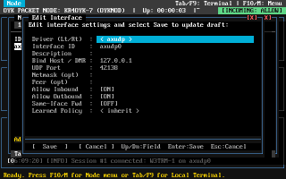](images/ui-gallery/ncurses_edit_iface.png) **14. Edit Iface** | [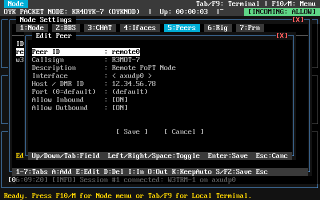](images/ui-gallery/ncurses_edit_peer.png) **15. Edit Peer** | [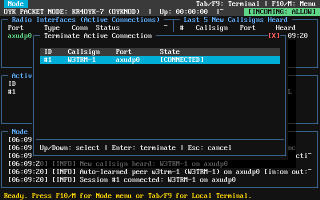](images/ui-gallery/ncurses_terminate.png) **16. Terminate** |
| [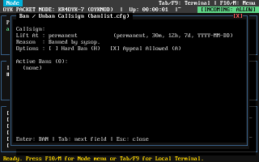](images/ui-gallery/ncurses_ban.png) **17. Ban/Unban** | [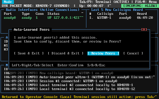](images/ui-gallery/ncurses_exit.png) **18. Exit/Boot** | [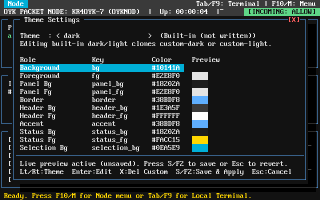](images/ui-gallery/ncurses_theme.png) **19. Theme** | [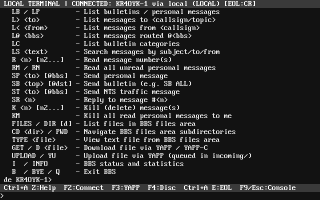](images/ui-gallery/ncurses_terminal.png) **20. Terminal** |
| [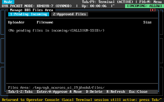](images/ui-gallery/ncurses_files.png) **21. Files** | [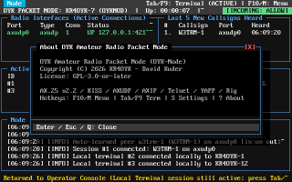](images/ui-gallery/ncurses_about.png) **22. About** |  |  |

## MS-DOS (80x25 Text)

| | | | |
| :---: | :---: | :---: | :---: |
| [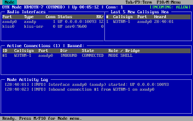](images/ui-gallery/dos_main.png) **1. Console** | [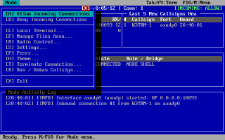](images/ui-gallery/dos_menu.png) **2. Node Menu** | [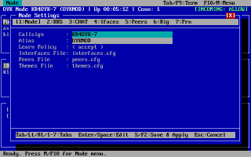](images/ui-gallery/dos_settings.png) **3. Set: Node** | [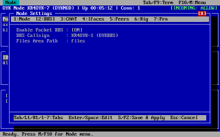](images/ui-gallery/dos_settings_bbs.png) **4. Set: BBS** |
| [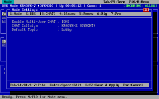](images/ui-gallery/dos_settings_chat.png) **5. Set: CHAT** | [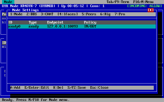](images/ui-gallery/dos_settings_ifaces.png) **6. Set: Ifaces** | [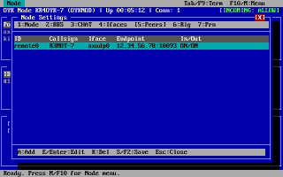](images/ui-gallery/dos_peers.png) **7. Set: Peers** |  **8. Set: Rig** |
| [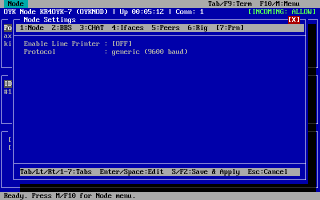](images/ui-gallery/dos_settings_printer.png) **9. Set: Printer** | [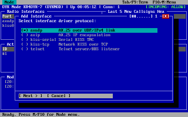](images/ui-gallery/dos_add_iface_1.png) **10. Wiz 1: Driver** | [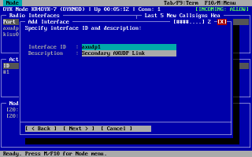](images/ui-gallery/dos_add_iface_2.png) **11. Wiz 2: Identity** | [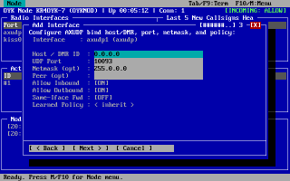](images/ui-gallery/dos_add_iface_3.png) **12. Wiz 3: Policy** |
| [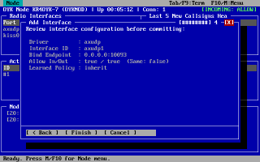](images/ui-gallery/dos_add_iface_4.png) **13. Wiz 4: Review** | [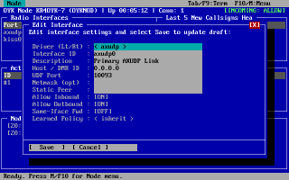](images/ui-gallery/dos_edit_iface.png) **14. Edit Iface** | [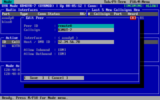](images/ui-gallery/dos_edit_peer.png) **15. Edit Peer** | [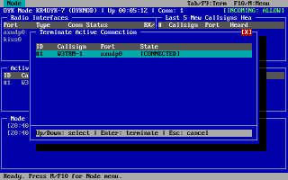](images/ui-gallery/dos_terminate.png) **16. Terminate** |
| [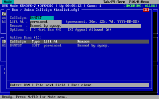](images/ui-gallery/dos_ban.png) **17. Ban/Unban** | [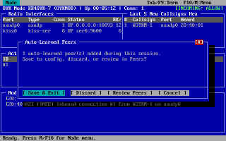](images/ui-gallery/dos_exit.png) **18. Exit/Boot** | [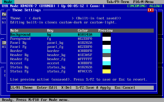](images/ui-gallery/dos_theme.png) **19. Theme** | [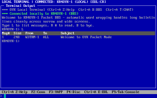](images/ui-gallery/dos_terminal.png) **20. Terminal** |
|  **21. Files** | [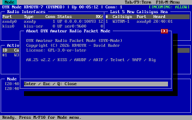](images/ui-gallery/dos_about.png) **22. About** |  |  |

## MS-DOS 386+ Graphical (VBE/VGA/EGA)

| | | | |
| :---: | :---: | :---: | :---: |
| [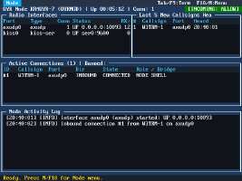](images/ui-gallery/dos_gfx_main.png) **1. Console** | [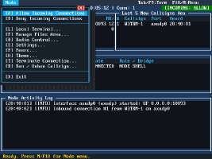](images/ui-gallery/dos_gfx_menu.png) **2. Node Menu** | [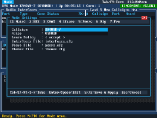](images/ui-gallery/dos_gfx_settings.png) **3. Set: Node** | [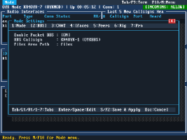](images/ui-gallery/dos_gfx_settings_bbs.png) **4. Set: BBS** |
| [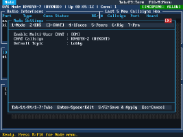](images/ui-gallery/dos_gfx_settings_chat.png) **5. Set: CHAT** | [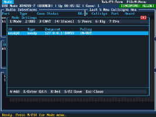](images/ui-gallery/dos_gfx_settings_ifaces.png) **6. Set: Ifaces** | [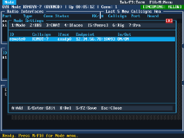](images/ui-gallery/dos_gfx_peers.png) **7. Set: Peers** | [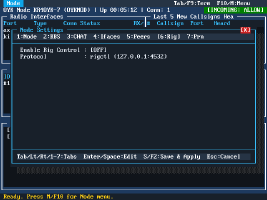](images/ui-gallery/dos_gfx_settings_rig.png) **8. Set: Rig** |
| [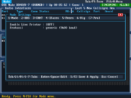](images/ui-gallery/dos_gfx_settings_printer.png) **9. Set: Printer** |  **10. Wiz 1: Driver** |  **11. Wiz 2: Identity** |  **12. Wiz 3: Policy** |
|  **13. Wiz 4: Review** |  **14. Edit Iface** |  **15. Edit Peer** |  **16. Terminate** |
|  **17. Ban/Unban** |  **18. Exit/Boot** |  **19. Theme** |  **20. Terminal** |
|  **21. Files** |  **22. About** |  |  |

## Teensy 4.1 / TinyTMUX (VT340/xterm-256color)

| | | | |
| :---: | :---: | :---: | :---: |
|  **1. Console** |  **2. Node Menu** |  **3. Set: Node** |  **4. Set: BBS** |
|  **5. Set: CHAT** |  **6. Set: Ifaces** |  **7. Set: Peers** |  **8. Set: Rig** |
|  **9. Set: Printer** |  **10. Wiz 1: Driver** |  **11. Wiz 2: Identity** |  **12. Wiz 3: Policy** |
|  **13. Wiz 4: Review** |  **14. Edit Iface** |  **15. Edit Peer** |  **16. Terminate** |
|  **17. Ban/Unban** |  **18. Exit/Boot** |  **19. Theme** |  **20. Terminal** |
|  **21. Files** |  **22. About** |  |  |

## Raspberry Pi Pico (RP2040/RP2350 VT340/xterm-256color)

| | | | |
| :---: | :---: | :---: | :---: |
|  **1. Console** |  **2. Node Menu** |  **3. Set: Node** |  **4. Set: BBS** |
|  **5. Set: CHAT** |  **6. Set: Ifaces** |  **7. Set: Peers** |  **8. Set: Rig** |
|  **9. Set: Printer** |  **10. Wiz 1: Driver** |  **11. Wiz 2: Identity** |  **12. Wiz 3: Policy** |
|  **13. Wiz 4: Review** |  **14. Edit Iface** |  **15. Edit Peer** |  **16. Terminate** |
|  **17. Ban/Unban** |  **18. Exit/Boot** |  **19. Theme** |  **20. Terminal** |
|  **21. Files** |  **22. About** |  |  |

## ESP32-C6 (M5Stack Unit C6L VT340/xterm-256color)

| | | | |
| :---: | :---: | :---: | :---: |
|  **1. Console** |  **2. Node Menu** |  **3. Set: Node** |  **4. Set: BBS** |
|  **5. Set: CHAT** |  **6. Set: Ifaces** |  **7. Set: Peers** |  **8. Set: Rig** |
|  **9. Set: Printer** |  **10. Wiz 1: Driver** |  **11. Wiz 2: Identity** |  **12. Wiz 3: Policy** |
|  **13. Wiz 4: Review** |  **14. Edit Iface** |  **15. Edit Peer** |  **16. Terminate** |
|  **17. Ban/Unban** |  **18. Exit/Boot** |  **19. Theme** |  **20. Terminal** |
|  **21. Files** |  **22. About** |  |  |

## X11 GTK+ 2.0

| | | | |
| :---: | :---: | :---: | :---: |
|  **1. Console** |  **2. Node Menu** |  **3. Set: Node** |  **4. Set: BBS** |
|  **5. Set: CHAT** |  **6. Set: Ifaces** |  **7. Set: Peers** |  **8. Set: Rig** |
|  **9. Set: Printer** |  **10. Wiz 1: Driver** |  **11. Wiz 2: Identity** |  **12. Wiz 3: Policy** |
|  **13. Wiz 4: Review** |  **14. Edit Iface** |  **15. Edit Peer** |  **16. Terminate** |
|  **17. Ban/Unban** |  **18. Exit/Boot** |  **19. Theme** |  **20. Terminal** |
|  **21. Files** |  **22. About** |  |  |

## Windows GUI (Wine / Win32/64)

| | | | |
| :---: | :---: | :---: | :---: |
|  **1. Console** |  **2. Node Menu** |  **3. Set: Node** |  **4. Set: BBS** |
|  **5. Set: CHAT** |  **6. Set: Ifaces** |  **7. Set: Peers** |  **8. Set: Rig** |
|  **9. Set: Printer** |  **10. Wiz 1: Driver** |  **11. Wiz 2: Identity** |  **12. Wiz 3: Policy** |
|  **13. Wiz 4: Review** |  **14. Edit Iface** |  **15. Edit Peer** |  **16. Terminate** |
|  **17. Ban/Unban** |  **18. Exit/Boot** |  **19. Theme** |  **20. Terminal** |
|  **21. Files** |  **22. About** |  |  |

## Android (Material 3 / Jetpack Compose)

| | | | |
| :---: | :---: | :---: | :---: |
|  **1. Console** |  **2. Node Menu** |  **3. Set: Node** |  **4. Set: BBS** |
|  **5. Set: CHAT** |  **6. Set: Ifaces** |  **7. Set: Peers** |  **8. Set: Rig** |
|  **9. Set: Printer** |  **10. Wiz 1: Driver** |  **11. Wiz 2: Identity** |  **12. Wiz 3: Policy** |
|  **13. Wiz 4: Review** |  **14. Edit Iface** |  **15. Edit Peer** |  **16. Terminate** |
|  **17. Ban/Unban** |  **18. Exit/Boot** |  **19. Theme** |  **20. Terminal** |
|  **21. Files** |  **22. About** |  |  |

## Classic Macintosh (System 6.0.8 B&W 512x342)

| | | | |
| :---: | :---: | :---: | :---: |
|  **1. Console** |  **2. Node Menu** |  **3. Set: Node** |  **4. Set: BBS** |
|  **5. Set: CHAT** |  **6. Set: Ifaces** |  **7. Set: Peers** |  **8. Set: Rig** |
|  **9. Set: Printer** |  **10. Wiz 1: Driver** |  **11. Wiz 2: Identity** |  **12. Wiz 3: Policy** |
|  **13. Wiz 4: Review** |  **14. Edit Iface** |  **15. Edit Peer** |  **16. Terminate** |
|  **17. Ban/Unban** |  **18. Exit/Boot** |  **19. Theme** |  **20. Terminal** |
|  **21. Files** |  **22. About** |  |  |

## Classic Macintosh (Color QuickDraw 640x480)

| | | | |
| :---: | :---: | :---: | :---: |
|  **1. Console** |  **2. Node Menu** |  **3. Set: Node** |  **4. Set: BBS** |
|  **5. Set: CHAT** |  **6. Set: Ifaces** |  **7. Set: Peers** |  **8. Set: Rig** |
|  **9. Set: Printer** |  **10. Wiz 1: Driver** |  **11. Wiz 2: Identity** |  **12. Wiz 3: Policy** |
|  **13. Wiz 4: Review** |  **14. Edit Iface** |  **15. Edit Peer** |  **16. Terminate** |
|  **17. Ban/Unban** |  **18. Exit/Boot** |  **19. Theme** |  **20. Terminal** |
|  **21. Files** |  **22. About** |  |  |

## Apple IIGS GS/OS (QuickDraw II 640x200)

| | | | |
| :---: | :---: | :---: | :---: |
|  **1. Console** |  **2. Node Menu** |  **3. Set: Node** |  **4. Set: BBS** |
|  **5. Set: CHAT** |  **6. Set: Ifaces** |  **7. Set: Peers** |  **8. Set: Rig** |
|  **9. Set: Printer** |  **10. Wiz 1: Driver** |  **11. Wiz 2: Identity** |  **12. Wiz 3: Policy** |
|  **13. Wiz 4: Review** |  **14. Edit Iface** |  **15. Edit Peer** |  **16. Terminate** |
|  **17. Ban/Unban** |  **18. Exit/Boot** |  **19. Theme** |  **20. Terminal** |
|  **21. Files** |  **22. About** |  |  |

## Amiga Workbench (Intuition/GadTools OS 3.1/2.04/1.3 + AROS)

| | | | |
| :---: | :---: | :---: | :---: |
|  **1. Console** |  **2. Node Menu** |  **3. Set: Node** |  **4. Set: BBS** |
|  **5. Set: CHAT** |  **6. Set: Ifaces** |  **7. Set: Peers** |  **8. Set: Rig** |
|  **9. Set: Printer** |  **10. Wiz 1: Driver** |  **11. Wiz 2: Identity** |  **12. Wiz 3: Policy** |
|  **13. Wiz 4: Review** |  **14. Edit Iface** |  **15. Edit Peer** |  **16. Terminate** |
|  **17. Ban/Unban** |  **18. Exit/Boot** |  **19. Theme** |  **20. Terminal** |
|  **21. Files** |  **22. About** |  |  |

## Atari ST GEM (ST High 640x400 Monochrome + EmuTOS)

| | | | |
| :---: | :---: | :---: | :---: |
|  **1. Console** |  **2. Node Menu** |  **3. Set: Node** |  **4. Set: BBS** |
|  **5. Set: CHAT** |  **6. Set: Ifaces** |  **7. Set: Peers** |  **8. Set: Rig** |
|  **9. Set: Printer** |  **10. Wiz 1: Driver** |  **11. Wiz 2: Identity** |  **12. Wiz 3: Policy** |
|  **13. Wiz 4: Review** |  **14. Edit Iface** |  **15. Edit Peer** |  **16. Terminate** |
|  **17. Ban/Unban** |  **18. Exit/Boot** |  **19. Theme** |  **20. Terminal** |
|  **21. Files** |  **22. About** |  |  |

## Atari TT / VDI GEM (640x480 16-Color + EmuTOS)

| | | | |
| :---: | :---: | :---: | :---: |
|  **1. Console** |  **2. Node Menu** |  **3. Set: Node** |  **4. Set: BBS** |
|  **5. Set: CHAT** |  **6. Set: Ifaces** |  **7. Set: Peers** |  **8. Set: Rig** |
|  **9. Set: Printer** |  **10. Wiz 1: Driver** |  **11. Wiz 2: Identity** |  **12. Wiz 3: Policy** |
|  **13. Wiz 4: Review** |  **14. Edit Iface** |  **15. Edit Peer** |  **16. Terminate** |
|  **17. Ban/Unban** |  **18. Exit/Boot** |  **19. Theme** |  **20. Terminal** |
|  **21. Files** |  **22. About** |  |  |

